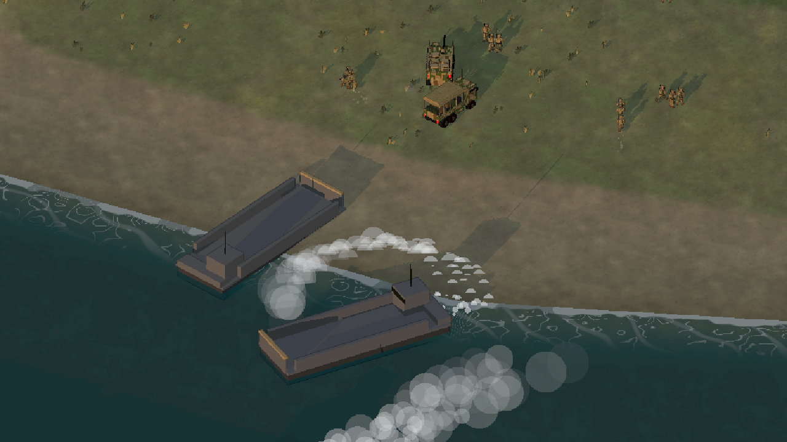
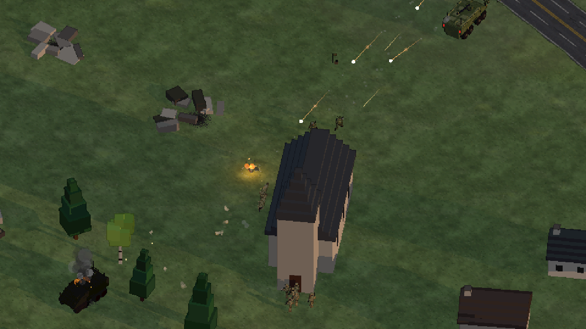
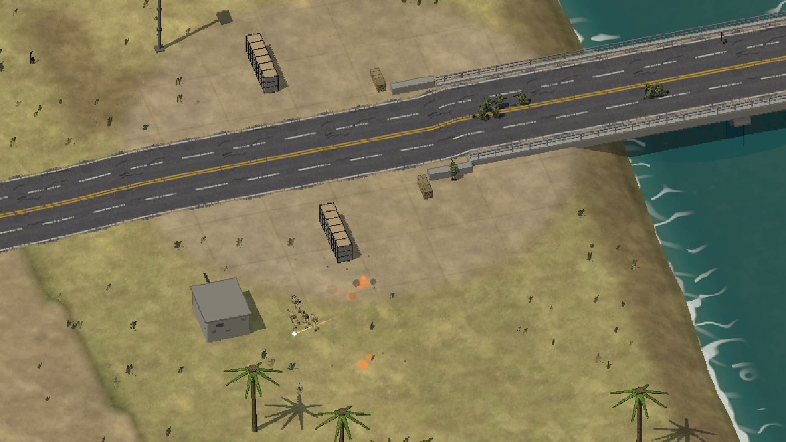
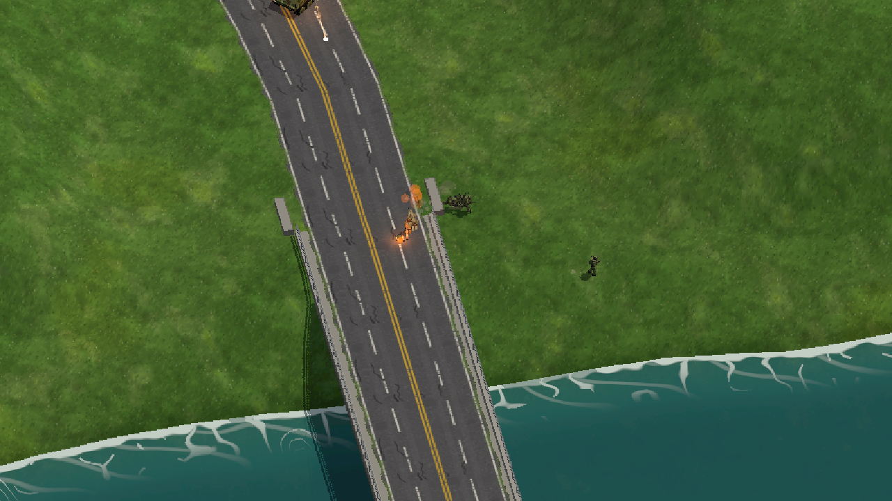
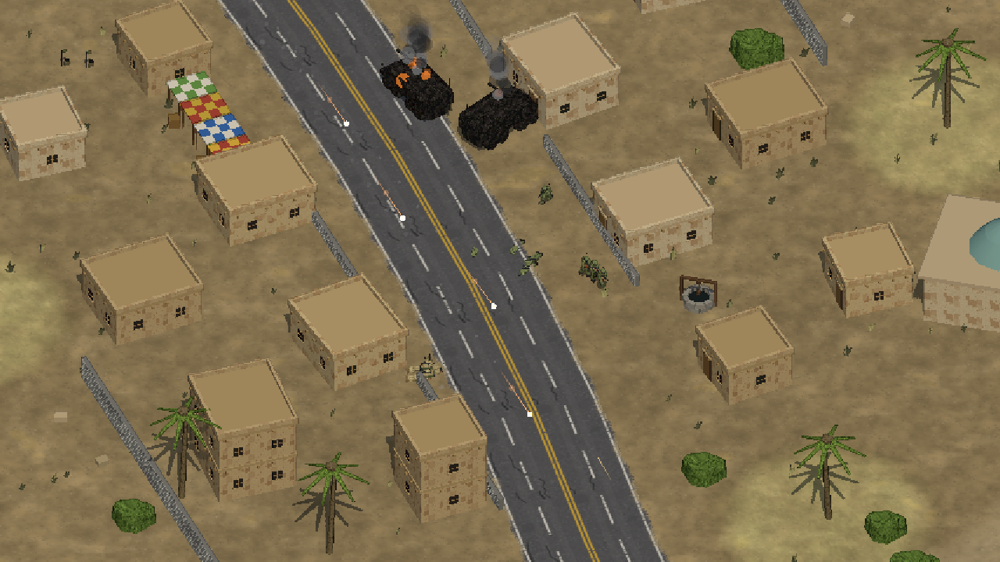
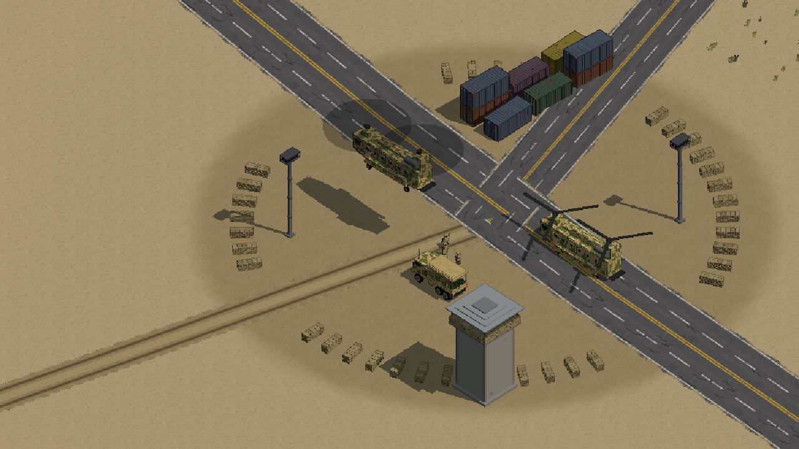
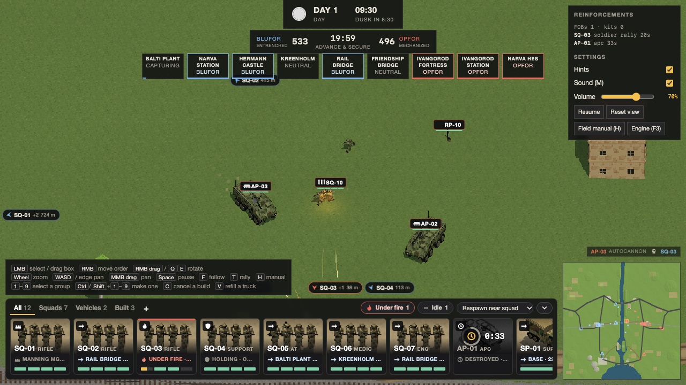

# Pixel Ops — 3D pixel-art engine sandbox

A browser sandbox for testing a "3D rendered as pixel art" RTS look, with two
interchangeable renderers behind one simulation:

- **raw WebGL2** back end with instanced batching (the default), no dependencies
- **three.js** back end (`?r=three`, legacy airfield sandbox only)

Low-poly units are rendered into a small buffer whose texel size is fixed in
**world** units, then upscaled with nearest filtering, so zooming in makes the
pixels chunkier while the camera rotates freely. No build step.

## Screenshots

<table>
<tr>
<td width="50%"><br><sub><b>Peninsula.</b> The first wave beaches at West Beach at dusk; the APC and supply truck are already heading up the sand.</sub></td>
<td width="50%"><br><sub><b>Peninsula.</b> Squads clash in the fields behind the village at dusk.</sub></td>
</tr>
<tr>
<td><br><sub><b>Palm Valley.</b> The fight for the Bridge, behind a row of tank traps.</sub></td>
<td><br><sub><b>Narva.</b> A fight for the end of the Friendship Bridge.</sub></td>
</tr>
<tr>
<td><br><sub><b>Desert Crossing.</b> APC wrecks burn on the road through the village.</sub></td>
<td><br><sub><b>Air Assault.</b> Chinooks lift off from the main base.</sub></td>
</tr>
<tr>
<td colspan="2"><br><sub><b>The match HUD</b> (Narva's railway bridge, fog of war on): the places and tickets along the top, reinforcements at the right, the unit strip and the minimap below.</sub></td>
</tr>
</table>

## Run

```bash
npm start            # python3 -m http.server 8787
open http://localhost:8787               # WebGL2, the game renderer
open http://localhost:8787/?r=three      # legacy three.js back end (160 m airfield sandbox only)
```

By default the **force builder** opens over the 2 km *Palm Valley* map. Its map cards
switch to Desert Crossing, Narva or Peninsula: the page reloads on the chosen map,
keeps your loadout and remembers the map. Its Opponent row has the built-in CPU or a
Llama commander. The Claude commanders are listed only while the engine panels are on,
because they spend the API key the gateway holds. Then spend
1,200 points on squads (rifle, support, anti-tank, medic, marksman, engineer),
vehicles (trucks, supply trucks, 8x8 APCs, M1 Abrams tanks, Chinook helicopters) and one doctrine
(Mechanized, Air Assault, Light Infantry, Entrenched), or pick a preset. Your
loadout is saved in the browser. The CPU reads it and counter-picks (never Air
Assault, which pays for landing troops on undefended objectives and needs your
hand), then a
25-minute **Advance and Secure** match starts: you command BLUFOR (tan) from the
south-west corner against OPFOR (olive) in the north-east. Five locations
(Outpost, Airfield, Village, Depot, Relay) are captured in order; holding the
majority bleeds the enemy's tickets, losing a location costs 20, and capturing all
five wins outright. Each side starts with 500 tickets; vehicle losses and
infantry respawns drain them, and the first team at 0 loses. Infantry are
expendable: 35 hit points, one ticket, back in 15 seconds in squad waves. Left-drag to select
squads, right-click to move them, click an enemy to attack-move, click the
minimap to jump the camera, and keep zooming out for the strategic view.

*Desert Crossing* (`?map=desert1km`) was built to be fair to both sides: the Village sits on the
strip of land between two parallel rivers, each bridged where the road crosses
it and fordable further out, and the village is laid out in mirrored pairs
along the road, so both commanders cross water to reach the centre and meet
the same cover when they get there.

`?loadout=air|mechanized|light|defensive|armoured|balanced` skips the builder,
`?cpuloadout=<preset>` fixes the CPU's pick, `?cpu=both` lets the CPU play both
sides, `?cpu=none` disables it, `?mode=skirmish` drops the objectives, and
`?sandbox=1` restores the free-roam airfield with no combat.

**Maps.** The game plays *Palm Valley* by default, a 2 km map mirrored about a river: three
lanes, each side's home row of three places capturable from the start, a place
capturable from any held neighbour, four of seven for the majority. The town lane
crosses by a footbridge only infantry can use, the road lane by the one vehicle
bridge, the open lane by a ford units wade at half speed. Each side's row is a
walled town (Kasbah, Souk), a fuel depot (Depot, Pumps) and a quarry beside a flooded
pit (Quarry, Mine); hesco walls and sandbags guard both ends of the bridge. Each
place lists sandbag positions covering its approaches, and the CPU digs in at the
ones facing the enemy. `?map=desert1km` plays Desert Crossing, the first 1 km map
(five places in a line; it favours the north-east base).

`?map=narva3km` plays *Narva*, a 3 km map of the Estonia-Russia border city (plan in
docs/GAME_PLAN.md). Its city kit and landmarks follow the user's voxel references: Soviet
panel blocks of five and nine storeys, garage rows, pine and birch, station yards with
wagons, a blue truss railway bridge, Balti's banded chimneys, Hermann Castle, Ivangorod
Fortress, the Kreenholm mills, the Town Hall, both railway stations and the hydro station
(dam, hall, switchyard). The Narva River runs
south to north from the reservoir: armour crosses on the dam, the railway bridge
and the Friendship Bridge, infantry also at Kreenholm's dry falls. BLUFOR
holds the Narva bank (Hermann Castle, Narva Station, Balti Plant), OPFOR the Ivangorod
bank (Ivangorod Fortress, Ivangorod Station, Narva HES), and the three river places
(Friendship Bridge, Rail Bridge, Kreenholm) sit on the crossings; five of nine for
the majority. North is up, as on a real map.

`?map=peninsula` plays *Peninsula* (blockout; plan at
https://claude.ai/artifact/6ELRURFGdPwxMJDvSNVuKN), a 1.2 km Invasion map and the
only mode it offers. A rocky peninsula runs north into the sea, cut off from the
mainland by a canal across its neck with one bridge. The attacker comes from the sea:
its main base is an assault ship off the west coast. Its helicopters fly from the flight
deck. Everything else waits in the well dock and goes ashore in three landing craft that
run fixed lanes to the beach you pick on the unit strip ("Land at ..."). North Cove takes
infantry only, so vehicles go to the nearest beach that takes them. A CPU attacker picks
the beach nearest the place it wants, avoiding beaches where it has seen defenders. Craft
can be shot, and a sunk one takes its load with it; it is replaced a minute later. A beach
whose place the attacker holds refills supply trucks. With none held, a truck waiting on
the beach rides a craft back to the ship and comes out full. The defender's base is on the
mainland, so everything it sends crosses the bridge.

Cliffs ring the coast except at three landings:
- West Beach: sand, open to vehicles.
- North Cove: under the cliffs, infantry only.
- The harbour quay on the east coast.

The three landing places (Village, Lighthouse, Harbour) are the attacker's home places,
so it can take any of them first. Radar Hill is in the middle, and the Bridgehead
guards the bridge. Whichever side you pick, the beach side attacks: defending, or a
balance run's `?swap=1`, plays the map from the mainland.

**Fog of war.** Your side sees what its units see: soldiers 120 m, APCs 160 m,
tanks 210 m, trucks 100 m, a landed helicopter 120 m and one in the air 250 m
(over buildings), FOBs and sandbag positions 100 m. Hills and buildings block
sight, so the ground behind them stays dark. Enemies out of sight are not drawn,
on the map or the minimap, and carry no name tag; where one was last seen a red
outline fades out over 30 s. A unit that fires shows to the side it shoots at
for 5 s, and whatever it shoots at is seen too. Enemy FOBs, sandbag positions
and rally points stay on the map once seen; objectives and capture progress
always show, and the enemy's radio, FOB and dig-in news stays out of your feed.
**Fog shading** in the right panel (or `?fogshade=0`) drops the darkening and
keeps only the hidden enemies. With the CPU on both sides the fog is off;
`?fog=1` shows team 0's view anyway, and `?fog=0` turns fog of war off for
everyone. The CPU plays by the same rules: it plans with what its side sees and
where it last saw the rest, takes a place you hold that it has not looked at for
half a minute to be defended by about a squad, and knows a place of its own is
under attack when its capture bar shows it (contested or draining).

Any static server works (ES modules can't load over `file://`). three.js comes
from jsDelivr via an import map; the WebGL2 back end loads nothing external.
The stats panel has a link that switches renderer while keeping the view.

**Logistics and air.** Supply trucks carry 100 supplies and refill inside your
main base. One with too little for any job (under 12), standing idle outside base and
feeding no build, drives home on its own, fills up and comes back to where it stood;
**V** (or the Refill tile) sends the selected trucks on that trip at any time, and a move
order on the way calls it off. The CPU sends its own home the same way and uses them
again once full; they drive with the canvas sides rolled up over the load, where a
plain truck keeps them down. Select an engineer squad standing within 20 m of a supply truck and
press **B** (or the Build FOB button) to raise a forward operating base in 20 s
(10 s under Entrenched); each FOB kit in your loadout allows one FOB. A FOB is a
spawn point: fallen infantry come back at whichever spawn is nearest their squad,
or nearest where they fell once the whole squad is down (main base, a FOB, the
squad's rally point, beside an idle helicopter under Air Assault or a parked troop
truck under Light Infantry, never one with an enemy within 30 m); the
reinforcements panel can force main base, a helicopter or a truck.

**FOB emplacements.** Within 50 m of one of your FOBs, an engineer beside a supply
truck builds a gun where he stands, facing the enemy's base: a **heavy machine gun**
(**G**, 20 supplies, 12 s; 120 m, long bursts that pin infantry), an **anti-tank
launcher** (**J**, 30 supplies, 15 s; a guided missile out to 200 m, three hits kill
an APC) or a **mortar** (**K**, 40 supplies, 18 s; it shells any enemy your side
can see 40 to 400 m away, no line of sight needed, each shell bursting over 7 m;
it fires at its tube's 52 degrees with the charge set for the range, 4 s in the air at
60 m and 10 s at 400 m). The gun swings on its mount to whatever its gunner is firing
at and back to the front when he has nothing. Three to a FOB, 8 m apart, clear of the FOB and the road. Each is a gun in a ring
of bags with one gunner's slot: select a squad and right-click (or tap) it to man
it (one man takes the gun, the rest wait behind it), **U** to leave; unmanned it does nothing. It can be destroyed (250 hp, about
three rockets) and costs 10 tickets when lost; once spotted it stays on the enemy's
map. The CPU builds them at the FOB nearest its front (a machine gun first, then the
launcher if it has seen your armour, else the mortar) and crews them with one
garrison squad, a man to a gun.

**Tank traps.** An engineer beside a supply truck presses **X** (or Tank traps) to
lay a row of steel hedgehogs, 15 m, across the road he stands on (centred on it;
off a road, across the way to the enemy's base), 20 supplies and 10 s. They stop
every vehicle, both sides', and infantry walk between them: close a bridge or a ford
and armour goes the long way round (route-finding tries the next crossing). Any
engineer standing at a row clears it with **X** in 8 s. Up to six rows a side. The CPU
lays them at the crossings its map lists (`chokes`) on its side, where enemy armour
still alive has come within 200 m in the last two minutes, and not on its own way
forward (an LLM commander can also order them), and clears the
enemy's near the place it pushes for and its own when they are in its way.

**Rally points.** Select a squad and press **T** (or the Rally button) to drop
its rally point where its leader stands, after Squad's rallies scaled to this
map: it needs a squadmate within 8 m, can't go down with an enemy within 30 m
(trying restarts the cooldown) or within 120 m of the enemy main, and a squad
can place one every 60 s, moving the old one. Squadmates whose nearest spawn is
the rally, or the whole squad once it is wiped out, come back there on the
rally's 30 s wave if they have been down at least 10 s, still 1 ticket each.
Any enemy within 18 m burns it. Enemy armour within 100 m of a rally doesn't
burn it but stops it being used: until the armour leaves, its men come back at
the next spawn (a FOB or main) instead, and no rally can be dropped there. The
CPU drops rallies once its squads reach the area they were sent to, and moves
one that enemy armour sits on, so expect to hunt them. Destroying a FOB radio costs its owner
40 tickets, so the CPU raids yours and defends its own.

**Transport.** Helicopters and trucks carry eight soldiers (two squads), an APC
four (one squad); a supply truck carries cargo, not troops. With infantry
selected, press **L** (or the Load button) and click or tap a friendly helicopter,
truck or APC, or right-click it (on a touch screen, hold on it; a plain tap on a
vehicle selects it). Infantry and a vehicle selected together board at once on
**L**. After Load the vehicle becomes the selection, ready to drive. The soldiers
walk to it (a ground vehicle's tail) and get in once it has stopped or landed, and
anyone past the seats stays behind. They stay aboard however often the vehicle
stops, until **U** (or the Unload button) lets them out, stopping a ground vehicle
where it is. A helicopter you send somewhere does not land: it circles there (30 m
out, 8 m/s), its door gun working on everything in reach, until **U** (Land and
unload, or Land when empty) puts it down where it is and lets the passengers out.
The CPU's own rides still drop their squad where the vehicle stops or lands. A truck or APC destroyed
with troops aboard throws them out hurt; a helicopter shot down in the air takes
them with it. The CPU uses its trucks to ferry a squad from around
base toward a far objective, stopping 120 m short, and an APC leaving base takes
a squad with it; its helicopters fly anyone stranded at main base (waiting up to
15 s for a fuller load) to 70 m short, and under Air Assault one helicopter parks
130 m short of the objective, clear of enemies and armour, as a forward spawn,
taking off when it is hit or threatened. A CPU helicopter with nothing to carry
flies fire support: it hovers 40 m from the biggest knot of enemy infantry near
the fight, broadside so a door gun (an M240: 80 m, 14-round bursts) bears, never
within reach of an APC's autocannon and with at most one launcher within 150 m
(anti-tank squads come for helicopters from that far), and
goes home when it drops below 70%. A helicopter landed in its own main base is
repaired by the ground crew (full in a minute), and an unguided rocket at a
helicopter in the air hits a third as often as at a ground vehicle, or twice that
when braced for it: the CPU sends an anti-tank squad at any enemy helicopter
within 150 m of its squads (or 180 m of an anti-air post an LLM commander set,
the `antiair` job, whose squad answers only helicopters over its own place); the
squad closes to 75 m and stands to fire, braced, and gives up once no other squad
is under the helicopter (the hunter alone does not keep the hunt going). Hovering
60 m from such a squad, a helicopter went down in 20 to 54 s in five tries (two in
five before, the others getting away at 225 to 288 hp). Its supply trucks pull back to base when
enemy armour comes within 120 m. An engineer
beside a supply truck can also throw up a **sandbag position** (**N**, 12
supplies, about 12 seconds, up to eight per side): a U of bags open to the rear
with four firing slots, two against the front wall and one against each side.
With infantry selected, right-click (or tap) a friendly position to **man** it:
up to four soldiers walk in through the back and take a slot each (the rest stay
put), hold it, and face out over the bags. Manned, a soldier is about a third as
likely to be hit from the front and sides (against a half behind any low cover)
and takes half the suppression; through the open rear he has no protection. Any
other order, or **U** (the Leave position button), takes them out. The CPU digs
in the same way at the location it holds, up to three positions there (in front
of the middle and on both flanks, off the road), preferably in a lull and after
its FOB while it has a kit; it mans them, keeps the manning squads in place and
still counts them toward its attack share. The CPU
commander builds a FOB one hop behind its front and lifts squads toward distant
objectives. It is cautious: squads close to about 35 m of a defended objective
and shoot from there, fall back when an enemy gets inside 22 m unless they hold
the zone or clearly outnumber it, and its APCs keep a 70 m standoff (tanks 90 m),
reversing away when something gets inside 50 m. Armour sent at a place it cannot drive to (an
island or a footbridge), or whose standoff point falls in a
river, supports from a spot it can reach on its own bank within its gun's reach,
in sight of the place where there is one; an APC's drop-off point gets the same
check. Squads an enemy APC or tank can
see get behind the nearest building or hill out of its sight and stay there while
it is about; anti-tank squads stalk it to rocket range instead, unless more than a
squad of infantry or another APC or tank stands round it. An enemy APC near one of
its squads draws the nearest anti-tank squad within 300 m, escorted armour excepted. Squads walking to
hold, reserve, screen or grab a place go round known enemy positions when the
way there passes within reach of their guns: by one of the CPU's own places or
a neutral one, if that walk is no more than two and a half times as long.

**M1 Abrams.** The tank (380 points, 15% off under Mechanized; the *Armoured*
preset brings one) carries a 120 mm gun that reaches 200 m, one round every five
seconds: 220 damage to a vehicle, a dead soldier on a hit and suppression
around every landing, behind 1,200 hit points. Explosive hits count by facing:
60% on the front plate, 125% on the sides and double from behind, so rockets
kill it in five hits from the rear, eight from the side and seventeen from the
front. A co-axial machine gun fires six-round bursts at infantry the turret is on
(out to 90 m), and soldiers inside 60 m take priority over vehicles, since they
carry the rockets. It costs 30 tickets when it dies and comes back after 150 seconds
(105 under Mechanized). BLUFOR's is in tri-colour desert camo, OPFOR's in olive.

**Utility commander.** The CPU is commanded by a utility AI
(`src/game/ai/utility.js`; `?ai=rules` brings back the older built-in planner,
which it beats 15-1 head to head): every plan tick it measures shared
considerations (force ratio at each location, enemy armour that can see a
point, ticket pressure from the last three minutes and the majority, time
pressure, readiness, travel from the nearest spawn), scores the options of
each decision from them and picks the best. It decides the attack target or
none, the locations to hold, the attack share, posture, what the engineers
build, helicopter lifts, whether to wait before attacking, and a job for every
squad (assault, hold, reserve, screen, raid, escort), and says what it is doing
on the radio. A bonus for the current choice that decays over a minute stops it
dithering, and difficulty adds noise to the scores. `?persona=aggressive` or
`patient` changes its weights; `?ai=utility,rules` sets each side separately
for CPU-versus-CPU tests. It works in Advance and Secure and Invasion; other
modes keep the built-in planner. With `?commander=1` (or the force builder's Opponent row) a fresh LLM plan takes
precedence and the utility AI fills the gaps.

**Game modes** (picked in the force builder, or `?mode=` with `?side=attack|defend`):
- *Advance & Secure*: capture the five locations in order; majority bleed; take all to win.
- *Invasion*: defenders start with every location and 300 tickets against the attackers'
  500; attackers must take them all before the 20-minute clock, each capture costs the
  defenders 15 tickets.
- *Destruction*: three weapon caches hidden near the defenders' locations, one active at a
  time and revealed when attackers come close or after 90 s; destroying all three before the
  20-minute clock wins, each costs the defenders 40 tickets.
- *Territory Control*: a hex grid over the map; capture only hexes touching your own; more
  hexes bleeds the enemy; 80% of the land wins outright.
- *Skirmish*: tickets only.

## Controls

**Field manual and hints.** `H` (the Field manual button, or `?` on a touch screen)
opens the field manual: how to win, the controls, squads and kits, what FOBs and
rally points are for and when to use which, sandbags, transport, vehicles and fog
of war, with the numbers read from the game's rules. The game pauses while it is
open, and it opens by itself on the objective page at your first match. Short hints
appear the first time something becomes useful (engineers beside a supply truck, a
squad far from home, an empty sandbag position, enemy armour in sight, a place of
yours being taken); each shows once per browser, and the Hints setting turns them
off. On a touch screen both name the buttons instead of the keys
(`src/core/guide.js`).

| Input | Action |
|---|---|
| Left click / drag | Select unit or squad / box-select |
| Right click | Move order (selected squads and vehicles move in formation); on a friendly carrier, board it; on a friendly sandbag position, man it |
| `L` | Load: the selected soldiers board the vehicle clicked next (or the one selected with them); `L` again or `Esc` cancels |
| `U` | Unload a selected carrier, or take selected soldiers out of their sandbag position |
| `H` | Open or close the field manual (pauses the game); its Objective page explains the mode being played and your side |
| `F3` | Show or hide the engine panels (stats, spawning, render and world settings), hidden on a map until asked for; the Engine button does the same |
| `X` | With an engineer selected: lay a row of tank traps (beside a supply truck), or clear the row he stands at |
| `G` / `J` / `K` | With an engineer selected near one of your FOBs: build a heavy machine gun / anti-tank launcher / mortar emplacement (beside a supply truck) |
| Right drag, `Q` / `E` | Rotate camera (yaw + pitch) |
| Wheel | Zoom (changes pixel scale, keeps the point under the cursor fixed) |
| `WASD` / arrows / screen edge / middle drag | Pan |
| `F` | Follow the selected unit |
| `Space` | Pause simulation |
| `R` / Reset view | Default camera |
| `M` | Mute / unmute |
| `C` | Cancel the selected engineer's build (nothing is spent until a build finishes) |
| `V` | Refill: the selected supply trucks drive home, fill up and come back |
| `1`–`9` | Select a group (press twice to take the camera there) |
| `Ctrl` or `Shift` + `1`–`9` | Make a group of the selection |

### Unit strip and command bar

**The unit strip** along the bottom has a card for every squad, vehicle and build of
yours: a portrait, the label, what it is doing ("Depot · 89 m", "Taking Quarry 54%",
"Supplying SQ-07", "Back in 0:17 · RP-04") and a bar per man (yellow when wounded, grey
when dead) or a health bar (supply trucks add their supplies, carriers their free
seats). A card goes red along the top for a few seconds after its unit is hit or while
its men are pinned down; a squad wiped out keeps its card, greyed, with a ring
counting down to its respawn (its rally's wave, or its own timer); a destroyed vehicle
counts down to its return at main; a build going up has a dashed card of its own.
Tap or click a card to select the unit, again to take the camera there, hold to
follow it (shift-click adds to the selection; after Load, a vehicle's card boards
it). Tabs filter All, Squads, Vehicles and Built; **+** makes a group of the
selection (its number shows on the cards, tap its tab to select it, hold the tab to
remove it). The **Under fire** and **Idle** chips step the camera through those
units, and the strip carries the respawn choice (near the squad, main base, or the
doctrine's helicopter or truck). Units out of view get a pointer on the screen edge
with their distance; pointers that would overlap merge ("SQ-01 +2"), and a tap takes
the camera there. The strip folds to its tabs with the arrow at its right end (it
starts folded on a screen under 560 px tall). Portraits are PNGs in `icons/units/`,
rendered from the game's own models by `node tools/make-portraits.mjs` (with the
game served on :8787).

**The command bar** above the strip shows the selection and its actions in groups:
**Orders** (Follow, Rally, Load, Unload or Land or Leave, Deselect) and, with an
engineer selected, **Build** (Sandbags, FOB, Traps or Clear, HMG, AT gun, Mortar), each
with its supply cost; the group's header shows the supply truck in range and the
FOB kits left. A tile that can't be used now says why in a word (NO TRUCK, NEEDS FOB,
TOO CLOSE...); tapping it gives the whole reason.

**Build countdown.** While an engineer builds, his name tag turns into a ring with
the structure's icon, filling as the work goes, and "SQ-07 · SANDBAGS 0:06", with a
dashed outline on the ground where it will stand. The build's tile counts down, the
other build tiles read BUSY and a Cancel tile appears (`C`). Pressing another build
says what he is on and when it is ready, with a Cancel button, instead of refusing.

### Touch (iPad)

Touch and pen pointers go to a gesture layer; a mouse or trackpad keeps the table above.

| Gesture | Action |
|---|---|
| Tap a unit | Select it (its whole squad) |
| Tap the ground (with a selection) | Move the selection there (a helicopter circles there until Unload or Land); tap an enemy to attack-move, a friendly sandbag position to man it |
| Double-tap a unit | Select every friendly unit of that type on screen |
| Hold on the ground | The same order as a tap (the ring fills in 0.45 s) |
| Hold with nothing selected, then drag | Box select |
| One-finger drag | Pan, with a fling on release |
| Pinch | Zoom about the midpoint |
| Twist | Rotate about the midpoint |
| Three-finger drag up/down | Tilt |
| Toolbar (top left) | **Box** arms a one-shot box select, **Pause**, **Base** jumps to your main, **?** the field manual, sound, **⚙** shows the engine panels. Follow and Deselect are in the command bar |
| Unit strip | Tap a card to select, tap again to go there, hold to follow; **+** groups the selection |

Tablets and phones (a coarse primary pointer with multi-touch) get the mobile
profile: device pixel ratio 1, a 2048 shadow map, no edge panning, keyboard hints
and engine panels hidden, larger tap targets, and the force builder as a scrolling
sheet. `?mobile=1` or `?mobile=0` forces the profile either way. The page ships a
web app manifest and icons, so "Add to Home Screen" installs it full-screen in
landscape; there is no service worker, so it still needs the server.

## Sound, difficulty and debrief

Sound is synthesized in WebAudio with no assets: filtered-noise shots per weapon,
explosions, impacts, looping rotor and engine voices for the nearest six
vehicles, and cues for selection, orders, captures, FOBs and the match result.
Everything positional is attenuated and panned around the camera target. The
context starts on the first click or touch; the Render panel has a mute box and
volume slider, the touch toolbar a note button, and `M` mutes. Recorded clips in
`sounds/` (listed in `sounds/manifest.json`) replace the synthesis where they exist,
and a sound may have several takes, one picked at random. Gunshots, the tank gun,
rockets, explosions, shell blasts and impacts are cut from CC0 recordings (the Free
Firearm Sound Library and Freesound; sources in `sounds/CREDITS.md`): BLUFOR
riflemen fire M4s, OPFOR AKs. The UI cues are ElevenLabs clips; to regenerate them,
put an ElevenLabs key in `.env` as `ELEVEN_LABS_API=...` (ignored by git) and run
`node tools/make-sounds.mjs`, or name the clips to redo: `node tools/make-sounds.mjs
win lose`. Delete the manifest to hear the synthesized set.

**Radio.** Your side has radio chatter (ElevenLabs voices, a radio filter and a
push-to-talk click): squads call contact, taking fire, man down or medic, enemy
armour, target down, reloading, moving, rally down and digging in; HQ reports
objectives secured or lost, the FOB up, under attack or lost, rallies overrun,
armour sighted, tickets running low, reinforcements and the result. One line plays
at a time and each has a cooldown, about four a minute in a busy fight. Vehicles
and helicopters loop recorded engines and rotors, bullets whizz past near misses,
AT gunners reload, engineers dig, and a desert wind and distant battle ambience
plays under the match, the battle swelling with the shooting.

The force builder picks the CPU difficulty. Easy CPU shoots and hits softer,
respawns slower and never builds FOBs; Hard shoots and hits harder, respawns
faster, gets an extra FOB kit, re-plans every few seconds and commits more of
its force to the attack. `?difficulty=easy|normal|hard` overrides it.

The match ends on a debrief: a ticket graph for both teams over the match and a
table of kills, losses by class, captures, locations lost, FOBs and caches, with
"Play again" and "Change loadout". The kill feed shows the killer's weapon and
the victim's class, and reports captures, FOBs and cache events; vehicle kills are
highlighted. Destroyed vehicles burn for 45 seconds with flames, embers and soot
before smouldering out; explosions throw debris on ballistic arcs and a dust ring.
Every shot starts at the muzzle with a flash scaled to the weapon (rifle, machine
gun, marksman, autocannon, rocket, door gun), and flashes and explosions cast a
brief orange light on the units and ground around them; glowing particles are
drawn additively, smoke covers. Rounds are in flight: the hit is decided on
the trigger but the damage lands when the round arrives, bullets draw tracer
streaks, cannon shells fly a gravity arc with a glowing head, rockets trail
smoke, and misses come down on the ground around the target. Infantry fire
bursts out to 60-110 m with low per-round accuracy that falls with range,
walking and firing until about 30 m, then stopping; the autocannon reaches
150 m. Line of sight (hills and tall obstacles) is required to engage, and a
soldier standing right behind a low wall, sandbags or a rock is half as likely
to be hit from across it, so walls are worth holding. Infantry stand to move, take a knee to
shoot, and go flat under heavy fire: rounds landing or bursting nearby build
suppression (machine guns and cannon far more than rifles), a suppressed soldier
aims worse and fires slower, and a kneeling or prone one is a smaller target
(80% and 60% of the hit chance) and only crawls until the fire lifts. Soldiers
carry the carbine across the chest and shoulder it while they have a target,
standing, kneeling or prone, with both hands kept on the weapon. Machine
gunners carry a belt-fed gun whose bipod comes down when they go prone;
anti-tank soldiers keep the launcher slung across the pack until they have a
target, then put it on the shoulder and sling the carbine.

URL parameters set the initial state so the two back ends can be compared on
identical frames: `?r=gl&seed=7&x=52&z=50&zoom=6&yaw=0.6&pitch=0.95&hour=21&pixel=0&tpu=12`

`?stage=soldier|truck|apc|tank|heli` spawns just that unit at the camera target, sends it
forward and follows it, for close-up inspection of models and animation:
`?r=gl&stage=soldier&zoom=10&yaw=1.2&pitch=0.8&hour=10`

`?warp=12` pre-steps the simulation 12 seconds before the first frame, so a
screenshot can catch a helicopter already airborne or a squad mid-run.


## Layout

```
index.html          page, HUD markup, picks the back end from ?r=
src/core/           renderer-agnostic engine
  math.js           Vec3, column-major Mat4, colour-space helpers, seedable rng
  layout.js         world size, props as data (hangar, containers, palms, bushes, grass tufts), obstacles, sun/moon lighting, WorldState
  terrain.js        heightfield from ridge/hill features with noise-jagged crests and notch passes, carved rivers with fords, level pads, coasts (land polygons whose edges are cliffs, beaches, coves or quays); height, normal, slope, water and line-of-sight queries
  models.js         unit models (soldier, truck, APC, tank, Chinook) built through a per-back-end factory
  geometry.js       box, cylinder, wedge, frustum, frond, ring, plane and grass-tuft generators with world-unit UVs
  textures.js       procedural tarmac (slabs, taxi lines, asphalt road, grass strip), camo and grass-tuft canvases
  camera.js         orthographic RTS camera (orbit, zoom-as-pixel-scale, texel snapping, follow)
  units.js          steering, obstacle sliding, separation, squads, helicopter state machine
  dust.js           particle simulation: dust, smoke, fire, tracers, muzzle flashes and brief flash lights for the renderer
  projectiles.js    rounds in flight: straight bullets, cannon shells on a gravity arc, rockets; tracer streaks for the renderer
  input.js, hud.js  RTS input / selection and the HUD (command bar, build markers); picking delegated to the back end
  roster.js         the unit strip: a card per squad, vehicle and build, tabs, groups, Under fire / Idle, edge pointers
  icons.js          glyphs, progress rings and the build names the strip and command bar share
  app.js            URL params, match or sandbox population, frame loop (with ?warp pre-stepping)
src/game/           milestone 1 game layer (renderer-agnostic)
  rules.js          tickets, costs, respawn timers, fixed M1 force
  weapons.js        weapon tables: range, bursts, accuracy, round speed, arcing shells
  teams.js          team state and base spawn points
  nav.js            A* grid (1 to 2 m cells by map) with foot / vehicle layers, a 1.15-weighted heuristic and string pulling; connected regions labelled up front and after each build
  spatial.js        hash grid for targeting and separation
  combat.js         targeting, line of sight (gridded obstacle test), burst fire, rounds in flight and the damage they land
  respawn.js        ticket charges and respawns at main base
  landing.js        landing craft for a side based on a ship (Peninsula): the well dock, lanes to the beaches, beach choice, held beaches as supply dumps
  ai/strategist.js  CPU commander: objectives, logistics (FOBs), air lifts, FOB raids
  objectives.js     capture zones, lattice order, ownership events
  modes/            game modes behind one interface: aas, invasion, destruction, territory, skirmish (objectives, tickets, win checks, HUD bar, minimap, CPU goals)
  loadout.js        force builder data: items, doctrines, presets, validation, CPU counter-pick, saved loadouts
  support.js        medic revives, engineer repairs, supply truck refills
  fob.js            forward operating bases: build rules, construction, spawn points
  ui/lobby.js       the pre-match force builder screen
  maps/             map definitions (valley2km.js, desert1km.js, narva3km.js, peninsula.js), the shared prop kit and ground texture generators (natural ground: fine low-contrast detail, 128 px over 12.8 m, one texel to a pixel of the game's buffer; everything bigger comes from the shader)
  match.js          AAS / Skirmish match flow, 10 Hz game tick, bleed, win checks
icons/units/        unit-strip portraits (tools/make-portraits.mjs renders them from the game's models)
src/three/          three.js back end: models, world, PixelRenderer (low-res target + outline), dust, markers
src/gl/             WebGL2 back end
  scene.js          Node / Mesh scene graph with the same position/rotation/visible surface
  shaders.js        GLSL ES 3.00: lit instanced, shadow depth, pick id, composite, dust (the ground blends rock onto slopes steeper than about 31 degrees, sampled from three sides; draws natural ground's patches, highlights, hollows and streaks from world-space noise at unrelated scales and turns, so nothing repeats, with zones of dry and lush grass over tens of metres)
  renderer.js       dynamic + chunked static instance batches, chunk culling, view-fitted shadow pass, splat ground, composite, pick buffer
  strips.js         road / line strip and decal geometry
  models.js, world.js, markers.js, main.js
```

## How the WebGL2 renderer works

- Every mesh is an instance of a shared geometry. Each frame the scene graph is
  walked once, world matrices are computed, and instance records (matrix, colour,
  emissive, pick id) are appended to a batch keyed by geometry + texture + flags.
  One `drawElementsInstanced` per batch. Every box and every straight cylinder, in
  unit models and map props alike, is a scaled unit one whose UVs the vertex shader
  scales back to world units from the instance's size, so a material is one batch
  rather than one per size: the units on screen cost about 20 batches a pass, a map
  chunk a dozen or two. Units and lamp heads outside the view by more than the light
  frustum's reach are not instanced at all.
- Shadow pass renders depth from an orthographic light camera into a 4096²
  depth texture (2048² on tablets). The light frustum is sized from the camera's
  footprint in quarter-octave steps and its eye is snapped to shadow texels, so the
  shadow grid stays still in the world while panning. The lit pass does a 2×2
  bilinear depth comparison thresholded at 0.5 with a normal-offset bias: edges stay
  hard but follow the sub-texel iso-line instead of the shadow texel staircase.
- Lighting is Lambert with three.js' physical units (irradiance / π, sRGB
  textures via `SRGB8_ALPHA8`, linear-to-sRGB in the composite), so both back
  ends produce the same image from the same `lighting(time)` values.
- Picking renders instance ids into a small colour buffer on click and reads
  one pixel; no CPU raycasting.
- Ambient life: a map's chimneys, hearths and the dam's tailwater are particle
  emitters (`layout.emitters`, ticked with the simulation and drifting on `map.wind`);
  landing craft leave a little foam astern and spray at the bow; a tank (an APC more lightly)
  belches exhaust as it pulls away from a stop; the lighthouse turns a beam at night; trees and bushes sway in the vertex
  shader (parts flagged `sway`, leaning by the square of their height over the
  ground). A match plays at the map's own hour (`map.hour`: Narva's low morning sun,
  Peninsula's evening, Desert Crossing's afternoon) unless the force builder's Time
  row or `?hour=` says otherwise, and opens with a flight from high over the map down
  to your base (any input ends it).
- Combat: tracers are streaks sized by the weapon (a tank's long-rod round white-hot
  over 14 m, machine guns 8 m, rifles 4.5 m); a miss spurts dirt and now and then
  ricochets; a hit on armour sparks and smokes. An explosion is a flash with two lights,
  a fireball, a shock ring along the ground, debris and embers on arcs, and a column of
  smoke; shells, rockets and dying vehicles leave scorch or crater decals (`World.marks`,
  150 at most, two minutes each) and shake the camera by their size and distance; a dead
  tank or APC cooks off for ten seconds.
- Water is a plane at the water level drawn after the opaque pass, lit like the
  ground and blended over the bed. Its shader reads a depth map built from the
  terrain: teal paling in the shallows, a broken foam rim at the shore and curling
  foam lines running out from it, measured as distance from the shore so steep
  banks get the same foam as gentle ones, and drifting ripples on a ford. The ground
  shader reads the same map for wet sand at the waterline.
- Fog of war darkens what the player's side cannot see from a per-cell texture,
  eased as it changes; enemies out of sight are skipped by the renderer.

## Tuning knobs (right panel)

Pixelate on/off (compare with native resolution at identical framing), outline,
shadows, fog shading, texels per unit (4–24), time speed, hour of day, autonomous orders,
spawn buttons.

## LLM commander on Cloudflare

A plain-language overview is in `docs/LLM_COMMANDER.md`.

The CPU sides can take their plan from a model instead of the built-in planner.
Every 20 seconds of match time each CPU side posts a one-page JSON digest of the
state (`src/game/ai/digest.js`: tickets, locations and who contests them, its
squads and vehicles with orders, enemy clusters as far as its side can see them
(fog of war: groups seen earlier carry `lastSeen`, for 30 s; each location's
`recent` keeps the most enemies seen at it at one look for two minutes, shown when
fewer are in sight there now), FOBs, sandbags, recent events,
and three memory blocks the game maintains so the prompt never grows: trends
(tickets now and 1, 2, 3 minutes ago, deaths and vehicle losses per minute,
locations that changed hands in the last five minutes), the last three plans
with what followed each (ticket swing, captures, losses, casualties), and the
model's own notes from last time) to `/commander` and gets back a plan in a fixed schema
(`src/game/ai/plan.js`: the next location to attack, locations to hold, attack
share, posture, what to build (a FOB, sandbags, tank traps or nothing, carried out
exactly), whether vehicles may carry squads from base (helicopters fly them, APCs
and troop trucks drive them), a line of radio chatter
that appears in the feed, notes to itself for the next call, how many seconds
until it wants to be consulted again, and optionally a condition to wait for
before attacking: squads gathered at a staging location, few enemies near the
objective, an APC alive, or a number of seconds; the game checks it every few
seconds, gathers the squads meanwhile, and gives up waiting after two minutes.
A location changing hands or one of its APCs dying triggers a review at once;
and jobs for particular squads by id: assault, hold or reserve at a location,
screen 50 m out from it towards the enemy, raid the nearest enemy FOB,
escort the supply truck, or grab a place the digest marks grabbable (one it can
take with no enemy it knows of in or near it; a grab anywhere else leaves that squad
to the attack share), with squads left out following the attack share; and jobs for
APCs and tanks by id: attack, or hold at one of its locations, with armour left out
going with the attack). The attack share is exact under a model (0 sends none of
the squads without a job; the built-in planners keep a fifth at least), an engineer
squad with neither a job from the model nor a logistics job waits at the first
hold, and a job the game will not carry out as given (a grab at a place that is not
grabbable, a hold at a place not ours, a raid with no enemy FOB known) comes back in
the next digest as `refused`, with the reason and what the squad does instead. The
strategist follows the plan while it is
under 90 seconds old and its own goals otherwise, and every call is
asynchronous, so a slow or failing endpoint never stalls the match. The posture
scales the caution distances (cautious keeps 1.3× the distance, aggressive
0.6×).

`worker/index.js` is a Cloudflare Worker that serves the game as static assets
(`.assetsignore` keeps secrets, tools and docs out) and answers `/commander`
from a Workers AI model, `@cf/meta/llama-3.3-70b-instruct-fp8-fast` by default
(`vars.MODEL` in `wrangler.jsonc`). Calls go through the `pixel-ops` AI Gateway
(`vars.GATEWAY`), which logs every digest and plan with the side and minute as
metadata, tracks tokens and cost, and rate-limits the endpoint; clear the
variable to call Workers AI directly. Measured, it answers in 2 to 9 seconds
for about 1,800 prompt tokens and 40 neurons a call, so a full match costs each
side roughly 3,000 neurons.

Claude answers on the same route with `?model=haiku`, `sonnet` or `opus` (Claude
Haiku 5.5, Sonnet 5.5, Opus 5.5). Those calls go through the gateway's Anthropic
endpoint with the official `@anthropic-ai/sdk`, on the Anthropic key stored in
the gateway (BYOK, alias `default`): the Worker sends only the gateway token
(`CF_AIG_TOKEN`, a Worker secret) and the gateway adds the key. The models think
before answering; `:low`, `:medium`, `:high`, `:xhigh` or `:max` after the key
sets the effort (`?model=opus:high`), otherwise each model's default applies. The
plan schema goes as a structured output (its numeric and length limits move into
the descriptions, and `validatePlan` enforces them). Measured on a Palm Valley
digest of 4,850 input tokens: Haiku in 3 to 5 s with 370 output tokens (about
$0.0007 a call), Sonnet in 7 s with 880 (540 of them thinking, about $0.019),
Opus in 12 s with 880 (about $0.037). At a call every 20 to 25 s a 20-minute
match costs a side about 3 cents on Haiku, $1 on Sonnet and $2 on Opus. The game
waits 60 s for an answer. The system prompt carries a prompt-caching marker: the
fixed part of every call (the system prompt and the format prompt structured
outputs add, 4,460 tokens) is stored for 5 minutes, every read restarting the
clock, and read back at a twentieth of the input price, so only the digest (about
1,600 tokens) is billed in full. Measured on Opus: about $0.029 a call, down from
$0.046. The `pixel-ops` gateway also caches whole responses: a byte-identical
request (in play only a repeated digest, e.g. while paused) gets the stored plan
back in under 100 ms.

```bash
npm install                      # wrangler
# .env holds CLOUDFLARE_API_KEY (an account API token with Workers AI), CLOUDFLARE_API_ACCOUNT
# and CF_AIG_TOKEN (the gateway's token, for Claude; wrangler dev reads it from .env, and
# `npx wrangler secret put CF_AIG_TOKEN` stores it for the deployed Worker)
set -a; . ./.env; set +a; export CLOUDFLARE_API_TOKEN="$CLOUDFLARE_API_KEY" CLOUDFLARE_ACCOUNT_ID="$CLOUDFLARE_API_ACCOUNT"
npm run dev:cf                   # the game and /commander on http://localhost:8789, AI binding remote
```

Add `&model=gpt-oss-120b`, `qwen3-30b`, `mistral-small`, `haiku`, `sonnet` or `opus`
to try another model from the Worker's allow-list for that match (`llama` is the default).
Then open `http://localhost:8789/?commander=1`, or keep playing from the Python
server and point it at the Worker with `?commander=http://localhost:8789/commander`
(the endpoint allows cross-origin calls). `npm run commander-stub` starts
`tools/commander-stub.mjs`, a local stand-in that answers with a heuristic
plan, for working on the digest without a model: `?commander=http://localhost:8788/commander`.
`npm run deploy` publishes the Worker to your account. Matches with a remote
commander no longer replay from a seed, so the balance runs keep using the
built-in planner.

## Headless checks

`tools/pick-test.mjs` launches headless Chrome (software GL), loads a URL, and
asserts that `app.pick()` returns the unit under each visible unit, then
box-selects and orders everything on screen. Run it against either back end:

```bash
node tools/pick-test.mjs 'http://localhost:8787/?r=gl&seed=11&zoom=2' 9351
node tools/pick-test.mjs 'http://localhost:8787/?seed=11&zoom=2' 9352
```

`tools/match-test.mjs` runs a CPU-vs-CPU match for a while and reports tickets,
objectives, FOBs, lifts and the kill feed. `tools/touch-test.mjs` drives the touch
layer with synthetic touches on an iPad-sized viewport (tap, tap-to-move, hold, Clear, drag, pinch,
twist, tilt, box select, double-tap) and checks the mobile profile and manifest:

```bash
node tools/match-test.mjs 'http://localhost:8787/?cpu=both&seed=11&warp=240&mode=invasion' 9333
node tools/match-test.mjs 'http://localhost:8787/?cpu=both&loadout=balanced&cpuloadout=balanced&seed=3&warp=1500&swap=1' 9334   # full mirrored match, sides swapped (map-balance check)
node tools/touch-test.mjs 'http://localhost:8787/?mobile=1&cpu=none&loadout=balanced&seed=5' 9341 /tmp/touch-profile shot.png
```

**Balance runs.** `tools/balance.mjs` plays CPU-vs-CPU matchups to the end, several at
once, stepping the simulation in the page as fast as it goes (a 25-minute match takes
about a minute), and prints every result with win tables per pairing, per preset and
per base. Each pairing is played both ways round by default, so each preset gets both
bases. Random numbers are seeded from the match seed and sound is off, so a seed
replays the same match: run the same seeds before and after a change to compare.
The runs play the default map, Palm Valley; `--extra map=desert1km` runs Desert
Crossing, whose 16 default matches serve as the regression set.

```bash
node tools/balance.mjs                                            # the core set: 4 pairings x 2 seeds x both bases
node tools/balance.mjs --pairs balanced:armoured,air:light --seeds 1,2,3,4 --parallel 4
node tools/balance.mjs --pairs light:mechanized --extra 'persona=aggressive' --json out.json
```

For a still frame, headless Chrome's `--screenshot` with `--virtual-time-budget`
works too; the `seed` parameter makes both back ends build the same scene.
